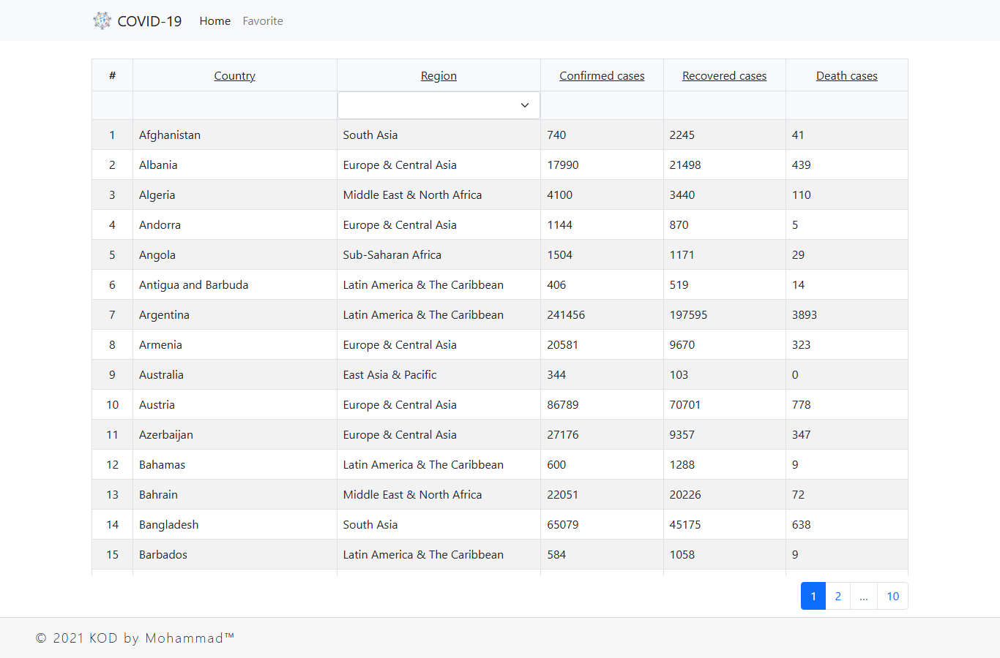

# Covid19-Cases

A full-stack web app that lists COVID-19 cases by country. It was built in three days
(September 8–11, 2021) as a take-home task for a full-stack developer job interview.



## What it does

An Express REST API over a COVID-19 data set, and a React single-page app on top of it:

- A paginated list of countries with their confirmed, recovered and death cases.
- Filter the list by region, and sort it by any column, ascending or descending.
- A details page per country, with its figures by date.
- Favorite countries, kept in the browser's local storage.
- Request and error logging on the server, and error handling on the client.

## Stack

| Part | Built with |
|---|---|
| `Server` | Node.js, Express 4, `mysql`, Winston logging |
| `Client` | React 17 (Create React App 4), React Bootstrap, Bootstrap 5, Axios |
| `Database` | MariaDB 10.4 / MySQL dump: `countries` (190 rows) and `covidcases` (17,670 rows) |

## API

The server listens on port 4000. Lists return 20 rows per page.

| Endpoint | Parameters |
|---|---|
| `GET /getCountriesList` | `pageNumber`, `filter` (region name), `sortBy` (see `Server/enum/sortBy.js`) |
| `GET /getAllRegions` | none |
| `GET /getCountryDetails` | `countryId`, `pageNumber` |
| `GET /getCountryCasesCount` | `countryId` |

## Run it locally

1. **Database:** on MariaDB or MySQL, create the database and the user that
   `Server/config.json` expects, then import the dump:

   ```sql
   CREATE DATABASE covid19;
   CREATE USER 'COVID19'@'localhost' IDENTIFIED BY 'COVID19';
   GRANT ALL PRIVILEGES ON covid19.* TO 'COVID19'@'localhost';
   ```

   ```bash
   mysql -u COVID19 -pCOVID19 covid19 < Database/database.sql
   ```

   These are local development credentials only. Change them in `Server/config.json`
   if your database uses others.

2. **Server:**

   ```bash
   cd Server
   npm install
   node app.js
   ```

3. **Client** (opens on http://localhost:3000 and calls the API set in `Client/src/config.json`):

   ```bash
   cd Client
   npm install --legacy-peer-deps
   npm start
   ```

   Create React App 4 was made for Node 14/16. On Node 17 or later, set
   `NODE_OPTIONS=--openssl-legacy-provider` before `npm start` or `npm run build`
   (PowerShell: `$env:NODE_OPTIONS="--openssl-legacy-provider"`). Tested on Node 24 this way.

## Releases

[v1.0.0](../../releases/tag/v1.0.0) has a 7z with the source, a ready client build and the
database dump.

## License

[MIT](LICENSE)
